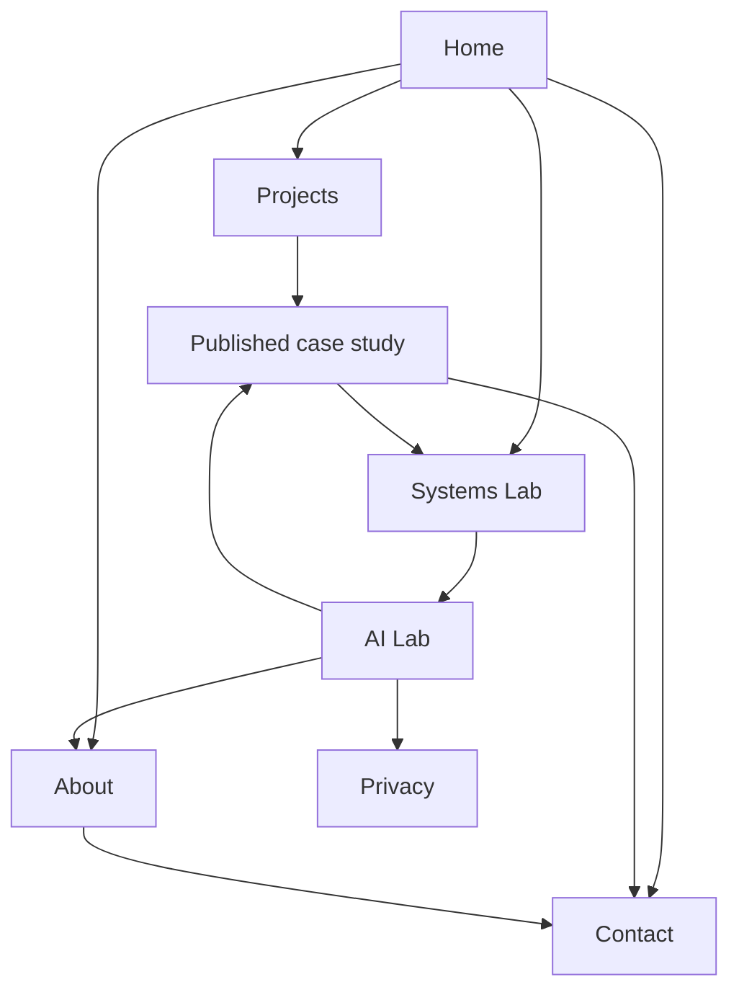

# Site Map

Phase 3 - Experience | Version 1.0 | 2026-09-30
Status: Planning deliverable complete. The Living Blueprint is provisionally approved. Implementation is not started.

## Authority

Approved Phase 1 documents remain unchanged and authoritative. Phase 2 CREATIVE_DIRECTION.md supplies Concept A. Maheen authorized Phase 3 without another approval question. This file defines the final proposed page set and navigation; it does not select technologies beyond the approved baseline or implement routes.

## Final page set

Eight page templates, including one repeatable project detail template. Every template has a desktop and mobile wireframe in PORTFOLIO_WIREFRAMES.pdf. Projects are provisional editorial content, not a promise that any unsupplied case study is ready.

| Page | Planned route | Recruiter question answered | Primary action | Content boundary |
| --- | --- | --- | --- | --- |
| Home | `/` | Who is Maheen and why explore her work? | Explore systems; View CV when supplied | Approved role, story, availability, avatar, short system preview and verified work when available |
| About | `/about` | What motivates her and how does she approach problems? | View CV; contact | Owner-supplied story, education, working principles; no invented work history |
| Projects | `/projects` | What has she built and what evidence is available? | Open a published case study | Flexible collection; no unsupplied projects, fake cards or old Wukala-GPT repository |
| Project case study | `/projects/[slug]` | What did she decide, contribute and learn? | Inspect architecture, evidence or working demo | Only published when supplied content is reviewed; template does not create a live empty route |
| Systems Lab | `/systems` | Can she explain the parts of a full-stack AI system? | Inspect one system relationship | Educational, labelled examples for Linux, Git, Docker, RAG, agents and API boundaries |
| AI Lab | `/ai-lab` | Can I explore her profile and AI workflow interactively? | Ask about Maheen; compare a job; inspect workflow | Portfolio-grounded answers, transparent matching, observable execution; no hidden reasoning display |
| Contact | `/contact` | How can we discuss an opportunity? | Email Maheen | Public email, phone and professional profiles; confirmed availability |
| Privacy | `/privacy` | What happens to the text I submit? | Return to AI Lab or contact | Plain-language handling of prompts/job text; final provider/retention facts must be resolved before release |

Privacy is a functional supporting page because AI interactions accept text. It is not a legal claim or a finished policy. It contains no invented provider, retention period or compliance statement.

## Navigation

Desktop: Maheen wordmark/home link; Work, Systems, AI Lab, About; distinct Contact link. Work opens `/projects` directly. No mega-menu or terminal toolbar. View CV is a contextual action on Home, About and Contact after the supplied file is ready; it is not a top-level destination.

Mobile: home wordmark, labelled Menu button, and a Contact link if space permits without crowding. Menu opens a compact navigation dialog with Work, Systems, AI Lab, About and Contact. Close control, Escape, focus containment and return to the opener are required. These are planned behaviours, not results of testing.

Footer: page links, email, GitHub, LinkedIn and Privacy. Show text labels beside icons. The public phone belongs on Contact; do not automatically equate it with WhatsApp service. No authentication, subscriptions or visitor accounts.

Case-study breadcrumbs: Home > Work > project title. Return to Work preserves the visitor's filter if feasible; direct visits still render normally. Titles are meaningful and unique. The 404 state gives Home and Work links and never exposes internal errors.

## Relationship map

Arrows represent useful contextual journeys, not a mandate to add every link to every page. Evidence links from AI Lab go only to existing public sources; absent project details must not become dead links.

## Recruiter journeys

| Journey | Route | Intended experience |
| --- | --- | --- |
| Fast screening | Home -> CV or Contact | Name, exact headline, location, availability and direct next action without animations or AI gates |
| Technical evaluation | Home -> Systems -> case study when published | Understand an example, then inspect real evidence; illustrative examples remain distinguishable |
| Evidence-first review | Work -> case study -> evidence/demo -> Contact | Problem, personal role, decisions, outcomes and limitations in readable order |
| Conversational review | AI Lab -> source link -> About/Work/Contact | Answers support existing content rather than replace navigation |
| Job-fit review | AI Lab -> Compare a role -> matched evidence and gaps | No unexplained fit percentage, inferred credentials or hiring recommendation |

## Systems Lab versus AI Lab

Systems Lab teaches how components relate. It is deterministic and works without an AI service. AI Lab performs user-triggered profile questions and job-text comparisons, and shows an execution trace when actual events are available. This separation keeps learning diagrams usable during provider outages and avoids placing all interaction on one overloaded page.

The common visual language is the Blueprint: the same label and connector style, readable white content, cyan selection, controlled violet around the avatar. It does not require a 3D world or persistent dashboard chrome.

## Conditional project publication

Projects may be absent at first content handoff. The Projects page then shows a brief honest message: “Project case studies will be added here.” It offers Systems Lab and Contact, without empty filters, fake thumbnails, fabricated status or a promised date. Home omits its selected-work module until at least one case study is publishable. Do not fill the gap with unrelated older projects.

One published project: a focused full-width entry; no filters. Multiple projects: a simple collection; introduce category filters only when there are enough entries to make them useful (recommended threshold: six published projects spanning at least two meaningful categories). The threshold is a UX choice, not a claim about current inventory.

Wukala-GPT may be included when its publishable copy is ready. It is one project, without an academic label and without its old repository URL. Contributions, media and metrics remain deferred until supplied. Missing metrics are omitted rather than shown as zero. Draft project routes are not linked, indexed or accessible as public case studies.

## Global states

| State | Planned treatment |
| --- | --- |
| CV file not yet supplied | Keep availability recorded as confirmed in planning; omit the live download action or replace it with a clear email request action. Never create a broken download link |
| AI unavailable or quota exhausted | Profile and sources remain readable; explain temporary unavailability, preserve entered text locally in the active view, provide a deliberate retry |
| Missing project media | Publish readable content only if sufficient verified evidence exists; omit broken/empty media slots |
| External demo unavailable | Keep case-study explanation available and distinguish a failed external link from the portfolio itself |
| No matches | Explain which information is missing; offer existing navigation rather than inventing a result |
| Reduced motion | Same content/order with immediate state changes; no scroll travel or pointer tracking |
| Unknown route | Clear not-found message and Home/Work links, using the normal shell |

## Decisions and tradeoffs

| Choice | Reason | Tradeoff | Performance | Mobile / accessibility |
| --- | --- | --- | --- | --- |
| Eight templates, no blog at launch | Each supports recruitment or functional disclosure; no writing inventory supplied | Less content-hub breadth | Fewer page families and assets | Short menu; plain headings and links |
| Separate Systems and AI Labs | Distinguishes explanations from actual AI runs | One extra destination | AI runtime need not load on Systems | Both remain linear and keyboard usable |
| Normal navigation plus contextual depth | Fast access and discoverable detail | Less immersive than a full-screen spatial world | No navigation renderer needed | Standard browser history and native scrolling |
| Email-first Contact | Uses confirmed data; avoids unnecessary form/backend scope | Visitor uses their email client | No contact API required for initial scope | Mail link plus selectable/copyable address |
| Privacy in footer and AI input context | Visitor can understand text handling | Adds a supporting page | Text-only | Readable before any submission |

## TODO

- [x] Define final page set, route purposes, journeys and content boundaries.
- [x] Specify provisional-project and missing-asset states.
- [x] Provide matching desktop/mobile wireframes for all eight templates.
- [ ] Phase 4: finalize technology boundaries, providers, data handling and design system.
- [ ] Later: populate CV and project evidence when supplied; no questions required now.
- [ ] Implementation only after the complete planning process is approved.
